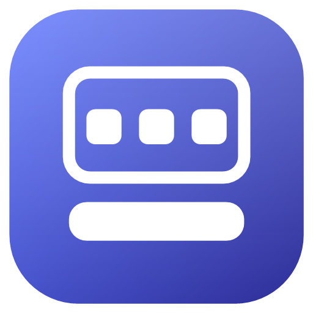
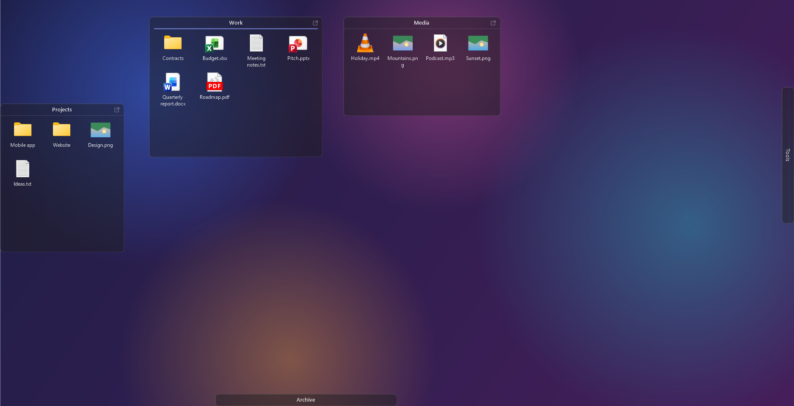
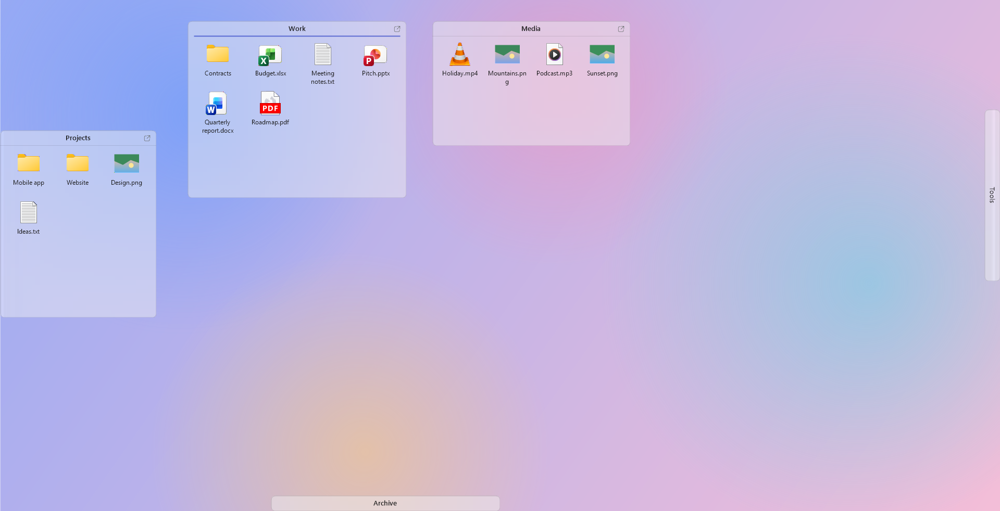
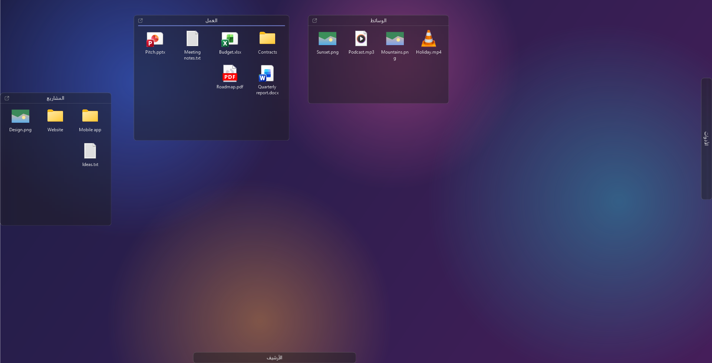
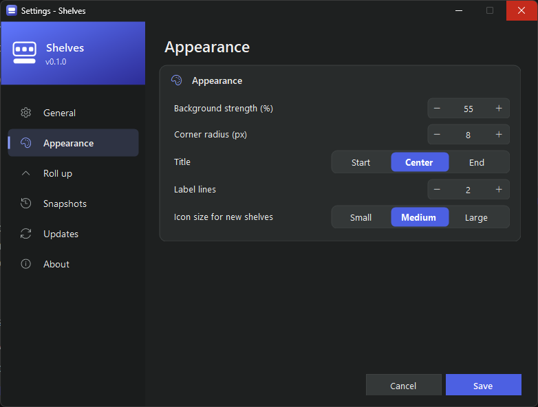
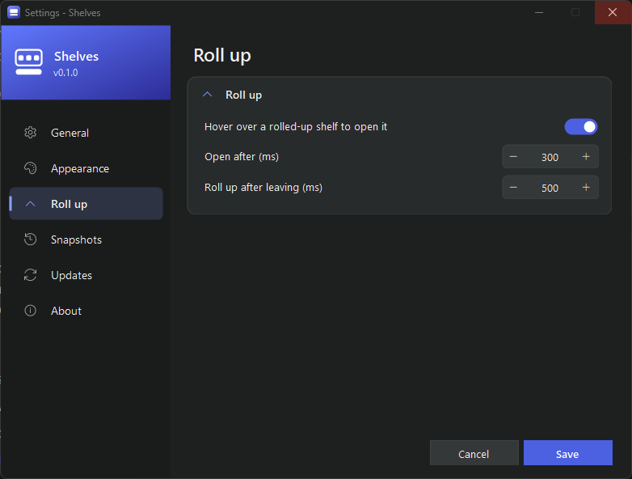
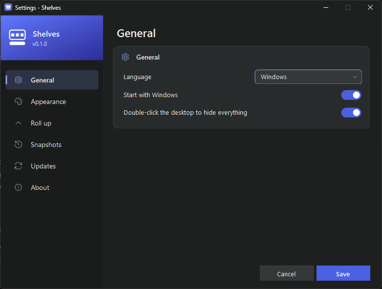
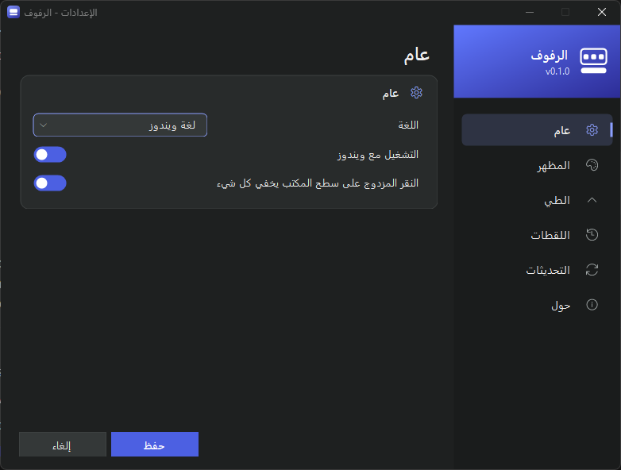

<div align="center">



# Shelves

**Group your desktop icons into shelves that roll up, on any edge of the screen.**

A small, native Windows app that keeps your real desktop icons in tidy, frosted-glass shelves.
Roll a shelf up to its title, dock it to the top, bottom, left or right edge, and hover to peek inside.

[](https://github.com/medovanx/shelves/releases/latest)
[](https://github.com/medovanx/shelves/actions/workflows/ci.yml)
[](LICENSE)


[**Download**](https://github.com/medovanx/shelves/releases/latest) | [Features](#features) | [Screenshots](#screenshots) | [Build](#build-from-source) | [العربية](#بالعربية)



</div>

---

## Features

- **Your real desktop icons.** Files stay on the Desktop. A shelf shows them with Windows' own icons and thumbnails and hides Explorer's copy. Double-click opens, right-click shows the real Explorer menu (Open with, Send to, Properties...), F2 renames, Delete sends to the Recycle Bin, and you can drag icons in, out and between shelves.
- **Draw a shelf.** Right-drag a box on the empty desktop and pick **Create shelf here**. A plain right-click still opens Explorer's own menu.
- **Roll up.** Double-click a shelf's title to roll it up to just its title bar, and hover over it to peek inside. It rolls back up when the mouse leaves.
- **Every edge.** Drag a shelf against the top, bottom, left or right edge and it docks there. A shelf on the left or right edge rolls into a thin vertical tab with its title turned sideways, and slides open across the screen. Shelves on the same edge sit side by side.
- **Folder portals.** Turn a shelf into a live view of any folder, such as Downloads, with the same icon actions.
- **Hide everything.** Double-click the empty desktop to hide every shelf and icon, and again to bring them back.
- **Frosted glass.** Shelves blur the wallpaper behind them, tinted to Windows' dark or light theme. With transparency effects off, they use a solid background.
- **Multi-monitor.** Each shelf remembers its monitor and its place as a share of the screen, so it survives resolution, scaling and taskbar changes. If its monitor is unplugged, it moves to the main one and goes back when the monitor returns.
- **Snapshots.** The layout is saved every day and before each update, and you can save and restore your own snapshots from the tray.
- **Safe.** Shelves never moves or deletes a file on its own. Deleting a shelf puts its icons back on the desktop, and on exit every icon returns to the exact spot it came from.
- **Moving from Fences.** **Import from Fences** in the tray menu turns Stardock Fences' fences into shelves, with the same names, places and icons.
- **English and Arabic.** Full right-to-left layout in Arabic.
- **Auto-updates.** Checks GitHub Releases, verifies the download's SHA-256 and updates itself in place.

## Screenshots

<table>
  <tr>
    <td align="center"><br><sub>Light theme</sub></td>
    <td align="center"><br><sub>Arabic, right to left</sub></td>
  </tr>
  <tr>
    <td align="center"><br><sub>Appearance settings</sub></td>
    <td align="center"><br><sub>Roll-up settings</sub></td>
  </tr>
  <tr>
    <td align="center"><br><sub>General settings</sub></td>
    <td align="center"><br><sub>Settings in Arabic</sub></td>
  </tr>
</table>

## Install

Download `Shelves.exe` from the [latest release](https://github.com/medovanx/shelves/releases/latest) and run it. It's a single portable file with no installer. Shelves starts with Windows unless you turn that off in Settings.

Close Stardock Fences or any other desktop-icon organizer first. Both would move the same icons.

## Usage

| To | Do this |
|---|---|
| Create a shelf | Right-drag a box on the empty desktop, then **Create shelf here**, or **New shelf** in the tray menu |
| Add icons | Drag them from the desktop onto a shelf |
| Take icons out | Drag them from the shelf onto the desktop |
| Roll up or open | Double-click the title |
| Peek inside a rolled-up shelf | Hover over it |
| Dock to an edge | Drag the shelf against the edge, or use **Dock** in its menu |
| Move or resize | Drag the title or any edge |
| Rename | **Rename** in the shelf's menu, or F2 with nothing selected |
| Show a folder | **Show a folder...** in the shelf's menu |
| Hide everything | Double-click the empty desktop |
| Undo a change | **Snapshots** in the tray menu |
| Put every icon back | **Restore desktop** in the tray menu |

## Settings

| Page | Options |
|---|---|
| General | Language, start with Windows, double-click to hide |
| Appearance | Background strength, corner radius, title alignment, label lines, icon size for new shelves |
| Roll up | Hover to open, open delay, roll-up delay |
| Snapshots | Save, restore and delete snapshots |
| Updates | Automatic checks, check now, GitHub page, release notes |

Settings, the layout and snapshots live in `%APPDATA%\Shelves`.

## How it works

Shelves reads Explorer's desktop through the shell's own `IFolderView2` interface and moves icons with the desktop list view's standard messages. Nothing is injected into Explorer. A shelved icon is parked far off screen, and its old position is saved so it can go back. If Explorer restarts or refreshes and brings an icon back, Shelves notices within a second and parks it again.

Shelf windows sit directly above the desktop and below every app window. They rise with the desktop when you use Show desktop (Win+D).

## Build from source

Requires the .NET 10 SDK on Windows.

```bash
dotnet build Shelves.slnx -c Release
```

```bash
dotnet test Shelves.slnx
```

```bash
dotnet publish src/Shelves/Shelves.csproj -c Release -r win-x64 --self-contained -p:PublishSingleFile=true -o publish
```

### Project structure

```
Shelves/
├── src/
│   ├── Shelves.Core/              Layout model, docking and roll-up geometry, snapshots, Fences import (no Windows code)
│   └── Shelves/
│       ├── Desktop/               Explorer's desktop view, keeping icons hidden, wallpaper blur, mouse hook, shell menus and drags
│       ├── UI/Shelf/              The shelf window: painting, icons, input, menus
│       ├── UI/                    Settings window, themed controls and menus
│       ├── Localization/          English and Arabic text
│       ├── Services/              Updater, log
│       └── DevTools/              --shots (README images on a made-up wallpaper) and --render-icon
└── tests/
    └── Shelves.Core.Tests/        xUnit tests: geometry, model, snapshots, Fences import
```

## بالعربية

**الرفوف** تطبيق صغير لويندوز يجمع أيقونات سطح المكتب في رفوف شفافة يمكن طيّها.

- **أيقوناتك الحقيقية:** تبقى الملفات على سطح المكتب، وتعرضها الرفوف بأيقونات ويندوز نفسها، مع قائمة المستكشف الكاملة والسحب والإفلات.
- **ارسم رفًا:** اسحب بالزر الأيمن مربعًا على سطح المكتب الفارغ، ثم اختر **إنشاء رف هنا**.
- **الطي:** انقر نقرًا مزدوجًا على عنوان الرف لطيّه، ومرّر المؤشر فوقه لفتحه مؤقتًا.
- **كل الحواف:** ثبّت الرف على الحافة العليا أو السفلى أو اليسرى أو اليمنى. على الحافتين الجانبيتين ينطوي الرف إلى شريط عمودي.
- **عرض مجلد:** اجعل الرف يعرض محتويات أي مجلد مباشرة.
- **إخفاء كل شيء:** انقر نقرًا مزدوجًا على سطح المكتب الفارغ.
- **لقطات:** يُحفظ الترتيب يوميًا، ويمكنك حفظ لقطاتك واستعادتها.
- **الانتقال من Fences:** استورد رفوف Stardock Fences بنفس الأسماء والأماكن.
- **العربية والإنجليزية** مع اتجاه كامل من اليمين إلى اليسار.

## License

[MIT](LICENSE)
